# Farmer User Flow — Agricultural Rotation Intelligence

_Intended farmer-facing product experience for the rotation-intelligence prototype. The current repository is a CLI research tool; maps, accounts, mobile UI, notifications, and monitoring are design proposals, not implemented features._

---

> **The one question this product answers:** “What should I plant next, and why might it be a better choice for my field?”

## 🎯 Product promise and users

The app helps a farmer understand what their field has done over the past seasons, explore a small number of realistic rotation options, and choose a plan without needing to understand satellites, models, or remote sensing.

It is a guide, not an oracle. It shows what is observed, what is estimated, what the farmer confirmed, and what is missing. It never claims that a rotation guarantees a better yield or profit.

### Primary user

| Attribute | Assumption |
|---|---|
| Who | Smallholder farmer managing one to five fields |
| Technology | Android smartphone, occasional 3G, sometimes offline |
| Literacy | Comfortable with icons, voice, and simple language; may not read technical charts |
| Language | Arabic first; English optional; right-to-left layout required |
| Units | Hectares or dunums; local crop names matter |
| Farming system | Rainfed or limited irrigation; mixed crop–livestock possible |
| Time | A few minutes between field work and family duties |

A secondary user is the extension agent or agronomist the farmer chooses to share a plan with. The farmer remains the decision-maker.

### Design rules

- **Farmer-first, not data-first.** Lead with the answer, then evidence, then technical detail.
- **Map-centered.** The field is the main object; every plan belongs to a field.
- **Progressive disclosure.** Show three things first: what the field did, what the options are, what to do next.
- **Visible uncertainty.** Use “strong / some / limited evidence” badges and plain reasons, not false precision.
- **Incomplete information is normal.** A farmer can analyze a field with only a boundary.
- **The farmer can correct the system.** Estimates are editable, and corrections improve later advice.
- **Explain every recommendation.** Every score and suggestion has a “Why?” view.
- **No raw NDVI on the main screen.** Translate vegetation activity into high, moderate, low, and timing.
- **No crop identification from vegetation alone.** The app may suggest “possible winter cereal” only as an estimate for the farmer to confirm.
- **No single unexplained score.** Comparisons show trade-offs by criterion; any composite appears only in advanced detail.
- **Mobile and offline-aware.** Saved results remain readable; field notes queue for sync.
- **The farmer decides.** The app supports judgment; it does not prescribe.

### What success looks like

- A farmer reaches a saved plan in under 15 minutes using only a field boundary.
- Every farmer can explain, in their own words, one reason for and one risk of the chosen plan.
- No farmer sees a recommendation without a visible evidence label and a way to ask why.
- The farmer can complete the journey with soil, market, or history data missing.

## 🗺️ Journey at a glance

```mermaid
flowchart TB
    accTitle: Farmer Journey from First Launch to Seasonal Monitoring
    accDescr: Complete farmer journey through farm setup, field analysis, history confirmation, priorities, strategy exploration, comparison, decision, and seasonal monitoring, with fallback paths for missing data and constraint conflicts.

    start([👋 First launch]) --> welcome[Welcome, language, units]
    welcome --> farm[Create farm profile]

    subgraph setup ["📍 Set up the farm"]
        farm --> add_field[Add a field]
        add_field --> locate{Location found?}
        locate -->|Yes| boundary[Draw or select field boundary]
        locate -->|No| manual[Enter coordinates or ask for help]
        manual --> boundary
        boundary --> details[Field name, irrigation, crops, notes]
        details --> analyze[Start field analysis]
    end

    subgraph understand ["🛰️ Understand the field"]
        analyze --> enough{Enough satellite history?}
        enough -->|Yes| overview[Field overview and simple timeline]
        enough -->|No| limited[Limited-data overview]
        limited --> review[Review estimated field history]
        overview --> review
        review --> correct{Farmer confirms history?}
        correct -->|Yes| priorities[Set priorities]
        correct -->|No| edit[Add or correct crops and dates]
        edit --> priorities
    end

    subgraph plan ["🌱 Plan the next rotation"]
        priorities --> constraints[Add practical constraints]
        constraints --> feasible{Any strategy fits constraints?}
        feasible -->|No| relax[Explain conflict and propose relaxing one constraint]
        relax --> constraints
        feasible -->|Yes| strategies[Explore three strategies]
        strategies --> compare[Compare side by side]
        compare --> ready{Ready to decide?}
        ready -->|No| draft[Save draft, ask a question, or share]
        draft --> compare
        ready -->|Yes| decide[Choose or modify a strategy]
        decide --> record[Record decision and reminders]
    end

    subgraph monitor ["📈 Monitor the season"]
        record --> dashboard[Seasonal dashboard]
        dashboard --> log[Log planting, rain, irrigation, harvest]
        log --> end_review[End-of-season review]
        end_review --> review
    end

    record --> finish([✅ Plan saved, monitoring continues])

    classDef action fill:#dbeafe,stroke:#2563eb,stroke-width:2px,color:#1e3a5f
    classDef decision fill:#fef9c3,stroke:#ca8a04,stroke-width:2px,color:#713f12
    classDef caution fill:#fee2e2,stroke:#dc2626,stroke-width:2px,color:#7f1d1d
    classDef success fill:#dcfce7,stroke:#16a34a,stroke-width:2px,color:#14532d

    class welcome,farm,add_field,boundary,details,analyze,overview,review,priorities,constraints,strategies,compare,decide,record,dashboard,log,end_review action
    class locate,enough,correct,feasible,ready decision
    class manual,limited,edit,relax,draft caution
    class finish success
```

### What the farmer feels at each stage

| Stage | Farmer’s question | App’s answer | Signal that it worked |
|---|---|---|---|
| Setup | “Is this for my farm?” | “Show me your field; we will do the reading.” | Farmer adds a boundary |
| Understand | “What happened here?” | “Here is the field’s recent story, in plain language.” | Farmer says “that looks right” |
| History | “Does it know my crops?” | “Here is our estimate; correct us.” | Farmer confirms or edits a season |
| Priorities | “Will it listen to me?” | “What matters most to you?” | Farmer ranks three priorities |
| Explore | “What are my options?” | “Three realistic sequences, with reasons.” | Farmer opens a strategy detail |
| Compare | “Which is better for me?” | “Here is the trade-off under your priorities.” | Farmer can name the key trade-off |
| Decide | “Do I have to follow it?” | “You choose; we save and share.” | Farmer saves, modifies, or rejects |
| Monitor | “How is it going?” | “Here is the season compared with the plan.” | Farmer logs an activity |

## 🧭 Navigation structure

### Main tabs

| Tab | Purpose | Contents |
|---|---|---|
| **Fields** | Farm and field home | Farm profile, field cards, add field, field status |
| **Plan** | Priorities, strategies, comparison, decision | Current field plan, saved drafts, decision record |
| **Monitor** | Seasonal updates and field logs | Expected vs observed, alerts, activity log, end-of-season review |
| **More** | Profile, language, help, privacy | Units, notifications, data credits, export, delete, support |

### Global elements

- **Field switcher** in the header on Plan and Monitor.
- **Sync badge**: “Saved on this phone”, “Syncing”, “Offline — saved results”.
- **Help button** on every screen: “What does this mean?” and “Talk to an agronomist”.
- **Back behavior**: never lose unsaved answers; drafts save automatically.
- **Primary action** is always one clear button at the bottom of the screen.

### Screen map

| ID | Screen | Parent | Primary action | Next |
|---|---|---|---|---|
| S1.1 | Welcome | — | Start my farm | S1.2 |
| S1.2 | Language and units | S1.1 | Continue | S1.3 |
| S1.3 | Farm profile | S1.2 | Save farm | S1.4 |
| S1.4 | Add field location | Fields | Use my location / Search | S1.5 |
| S1.5 | Draw field boundary | S1.4 | Save boundary | S1.6 |
| S1.6 | Field details | S1.5 | Analyze field | S2.1 |
| S1.7 | Farm home | Fields | Add field / Open field | S2.2 or S1.4 |
| S2.1 | Analysis progress | S1.6 | Continue in background | S2.2 |
| S2.2 | Field overview | S1.7 | Review history | S3.1 |
| S2.3 | How we know | S2.2 | Close | S2.2 |
| S3.1 | History review | S2.2 | Confirm / Correct | S3.2 or S4.1 |
| S3.2 | Add or edit crop | S3.1 | Save season | S3.1 |
| S4.1 | Priorities | S3.1 | Continue | S4.2 |
| S4.2 | Constraints | S4.1 | Continue | S4.3 |
| S4.3 | Priority summary | S4.2 | See strategies | S5.1 |
| S5.1 | Strategy list | S4.3 | Open strategy | S5.2 |
| S5.2 | Strategy detail | S5.1 | Compare | S6.1 |
| S5.3 | Adapt strategy | S5.2 | Save adaptation | S6.1 |
| S6.1 | Comparison | S5.1 or S5.2 | Choose | S7.1 |
| S6.2 | Why this difference | S6.1 | Close | S6.1 |
| S7.1 | Decision sheet | S6.1 | Save decision | S7.4 |
| S7.2 | Modify sequence | S7.1 | Save changes | S7.1 |
| S7.3 | Share with expert | S7.1 | Share | S7.1 |
| S7.4 | Decision recorded | S7.1 | Go to monitor | S8.1 |
| S8.1 | Seasonal dashboard | Monitor | Log activity | S8.2 |
| S8.2 | Log activity | S8.1 | Save | S8.1 |
| S8.3 | Alert detail | S8.1 | Mark reviewed | S8.1 |
| S8.4 | End-of-season review | S8.1 | Save review | S3.1 |

## 🏠 Stage-by-stage flow

### Stage 1 — Welcome and farm setup

**Goal:** get a farmer to a saved field with as few questions as possible.

#### S1.1 Welcome

A three-card introduction, not a feature tour.

> **Card 1:** “See what your field has done over the past seasons.”
>
> **Card 2:** “Compare a few realistic options for what to plant next.”
>
> **Card 3:** “Track the season and correct us when we are wrong.”

Actions:

- **Start my farm** — begins setup.
- **Try a demo field** — explores a clearly labeled example, not the farmer’s data.
- **I already have a farm** — restore from a saved farm on this phone.

> “We use free satellite and weather data. We do not need a soil test or a login to begin.”

#### S1.2 Language and units

- Arabic (default in the Palestinian context) or English; full RTL layout.
- Area unit: hectare or dunum; show both in small text when helpful.
- Optional: read-aloud mode, larger text.
- Optional notifications: in-app, SMS, or WhatsApp. Never assume a data connection.

#### S1.3 Farm profile

Minimal fields:

| Field | Required | Why |
|---|---|---|
| Farm name | No | Helps distinguish farms on a shared phone |
| Farmer name | No | Used only in greetings and shared summaries |
| Region / district | Auto-filled | Helps with local crop names and calendars |
| Main farming system | No | Rainfed, mixed, irrigated; can be set per field |

> “You can skip anything you do not want to answer. You can change it later.”

#### S1.4 Add field location

The map is the primary interface.

Actions:

- **Use my location** — GPS pin, then adjust.
- **Search for a village or landmark** — no need to know coordinates.
- **Enter coordinates** — for users who have them.
- **Draw boundary** — preferred.
- **I do not know the boundary** — creates a circular buffer around a point, clearly marked “approximate area”.

The screen explains the difference:

> “A drawn boundary gives better advice. A circle is a rough guide and may include roads, other fields, or buildings.”

#### S1.5 Draw field boundary

- Finger drawing with undo, drag points, and “snap to straight line”.
- Auto-calculated area, updated live.
- Minimum-size warning: “This field is very small for satellite advice. You can continue, but confidence will be limited.”
- Overlap warning if the boundary overlaps another saved field.
- “Save boundary” is disabled only when the polygon is invalid, never because the farmer is unsure.

#### S1.6 Field details

Only the field name is strongly encouraged. Everything else is optional.

| Question | Answer style | Skip behavior |
|---|---|---|
| Field name | Text, suggested from map | Auto-name “Field 1” |
| Approximate area | Auto-filled from boundary, editable | Keep auto value |
| Irrigation | Rainfed / supplemental / full; drip / sprinkler / flood / other | “Not sure” |
| Current crop | Searchable local crop list, “not sure”, “fallow” | “Unknown” |
| Previous crops | Chips for last three seasons, optional dates | “Not sure” |
| Soil test | Optional photo or values | Skip |
| Notes | Free text or voice note | Skip |

> “You can analyze now and add details later. Missing answers lower our confidence; they do not block you.”

#### S1.7 Farm home

Each field appears as a card:

- Map thumbnail with boundary.
- Field name and area.
- Status: **Needs review**, **Plan ready**, **Monitoring**, **Needs update**.
- Last satellite observation date.
- One-line summary: “Last season: possible winter cereal. Next: choose a plan.”

Empty state:

> “No fields yet. Add your first field to see its history.”

Actions: **Add field**, **Open field**, **Compare fields** (optional later).

#### Stage 1 states and recovery

| State | What the farmer sees | What they can do |
|---|---|---|
| Location permission denied | “We cannot use GPS. You can search for your village or enter coordinates.” | Search, enter coordinates, draw manually |
| No internet | “You can set up the field now; analysis will start when you are back online.” | Save draft, queue analysis |
| Boundary too small or invalid | Plain warning with the reason | Redraw, use a buffer, continue with lower confidence |
| Duplicate field | “This looks like a field you already saved.” | Open existing, save as new |
| Farmer does not know crops | “Not sure” option on every crop question | Continue with satellite-only history |
| Farmer abandons setup | Draft saved automatically | Resume from farm home |

### Stage 2 — Understanding the field

**Goal:** turn satellite and regional data into a short, honest field story.

#### S2.1 Analysis progress

Four plain-language steps:

1. “Finding clear satellite images.”
2. “Checking which pixels are field, cloud, or bare ground.”
3. “Reading rainfall, temperature, soil, and terrain.”
4. “Building your field story.”

The farmer can leave the screen. When finished, an in-app notification says: “Your field story is ready.”

If one source fails:

> “We could not get soil information for this area. Your field story is ready, but soil advice will be more general.”

The analysis never blocks on a single missing source.

#### S2.2 Field overview

The first screen must answer three questions in under ten seconds:

1. What did this field do?
2. How sure are we?
3. What should I do next?

**Header summary**

> “This field usually grows between November and May. It was mostly bare or fallow from June to November 2024. We have 110 clear satellite observations from January 2023 to December 2024.”

**Map**

- Field boundary.
- Small vegetation thumbnail or seasonal greenness strip.
- Toggle: “Field map” / “Vegetation history”.
- No raw index values by default.

**Story cards**

| Card | Farmer-facing content | Evidence label |
|---|---|---|
| Vegetation history | “Strong growth in spring 2023 and winter 2023–24; low activity in summer–autumn 2024.” | From satellite |
| Growing seasons | Two candidate seasons with dates and confidence | Estimated |
| Bare-soil periods | “Possible bare soil, stubble, or fallow: 17 Jun – 2 Nov 2024.” | Estimated |
| Rainfall | “About 556 mm a year; most rain in winter. The growing season received about 632 mm.” | Regional data |
| Temperature | “Mild winters, warm summers; no strong heat stress in the main season.” | Regional data |
| Soil moisture | “Not available for this area” or a seasonal pattern if a reliable product exists | Observed / unavailable |
| Soil | “Silty clay, pH 7.7, moderate organic carbon. This is a regional prediction, not a soil test.” | Regional data |
| Terrain | “568 m elevation; 27% slope — erosion is a real risk on this field.” | Regional data |
| Risks | “Steep slope, dry summer, limited soil test, possible low residue cover.” | Mixed |

Every card has a **“Why?”** link. Tapping it opens S2.3.

**What we know / what we estimated / what is missing**

> **Observed:** 110 satellite observations between 5 Jan 2023 and 25 Dec 2024.
>
> **Estimated:** season boundaries, bare-soil windows, soil moisture pattern (if available).
>
> **Missing:** crop species, yield, soil test, irrigation records, local prices.
>
> **Freshness:** last satellite image is 25 Dec 2024. The field story is updated when new clear images arrive.
>
> **Confidence:** medium. Good observation count, but no soil test and a small field.

**Actions**

- **This looks right** → S3.1.
- **Something is wrong** → S3.1 with correction mode open.
- **Ask an agronomist** → share a summary.
- **Download / share summary** → plain-language PDF or text.

#### S2.3 How we know

An optional drawer for the farmer, extension agent, or curious family member.

- Satellite source and resolution: “Sentinel-2, 10 m pixels, about every 5 days.”
- Observation dates used, and how many cloudy images were skipped.
- Weather source and grid size: “NASA POWER, about 55 × 60 km.”
- Soil source: “SoilGrids, 250 m prediction.”
- Terrain source: “SRTM, about 90 m.”
- Crop knowledge: “Indicative ranges from public agronomic references.”
- What the app does not know: crop species, yield, profit, pest pressure, salinity.

> “Satellites see vegetation activity. They do not see which crop is planted.”

#### Stage 2 states and recovery

| State | What the farmer sees | What they can do |
|---|---|---|
| No satellite history for the area | “We do not have enough clear satellite history here yet.” | Continue with manual history; set a reminder to check later |
| Very cloudy period | “Only a few clear images were available this season.” | Widen the season, review confidence, add farmer records |
| Field too small / mixed pixels | “This field is smaller than the satellite pixels can separate cleanly.” | Draw a tighter boundary, continue with lower confidence |
| Soil data missing | “Soil information is not available for this area.” | Continue; soil advice marked general; add a soil test later |
| Weather data missing | “Weather data is unavailable right now.” | Show satellite history only; retry later |
| Analysis partially failed | “Some information is missing, but your field story is ready.” | See what is missing; retry only that source |
| Farmer disagrees | “You know this field better than we do.” | Correct history; estimate is not treated as fact |

### Stage 3 — Complete the field history

**Goal:** combine satellite estimates with farmer knowledge, without pretending they are the same.

#### S3.1 History review

A three-season timeline, newest first.

Each season card shows:

- Season label: “2023”, “Summer 2024”, “2024–25”.
- Estimate: “Possible winter cereal” or “Low vegetation / bare soil”.
- Evidence chip: **Satellite estimate**.
- Actions: **Yes, that’s right**, **Change**, **This was fallow**, **I don’t remember**.

Example:

> **2023 — Possible winter cereal**
> Strong vegetation from January to April, then a decline. We cannot tell the crop species.
> [Yes, that’s right] [Change crop] [This was fallow]

After confirmation, the card switches to a **You told us** chip.

#### S3.2 Add or edit crop

- Searchable crop list with local names and common synonyms.
- “Not sure” and “Other” options.
- Planting month and harvest month, approximate is acceptable.
- Irrigated: yes / no / not sure.
- Notes or voice note.
- “Add another season” for older history.

Validation is gentle:

> “The harvest month is before the planting month. Is this a different season?”

Never argue with the farmer about what they remember. If the satellite estimate and the farmer disagree, keep both:

> “You said wheat. The satellite saw low vegetation in that period. We will trust your record and mark the satellite reading as unexplained.”

#### S3.3 History summary

A compact summary before moving on:

> “You confirmed wheat in 2023, fallow in summer 2024, and a failed chickpea trial in 2021. Two seasons are still unknown. Confirmed history improves the next comparison.”

Actions: **Continue to priorities**, **Edit history**, **Skip for now**.

#### Stage 3 states and recovery

| State | What the farmer sees | What they can do |
|---|---|---|
| No history at all | “We have no crop history yet. Add what you remember, or continue with satellite estimates only.” | Add season, skip |
| Farmer knows only the current crop | “That is enough to start.” | Add one season, continue |
| Satellite and farmer disagree | Both records shown with labels | Keep farmer record, edit, or add note |
| Dates conflict | Gentle inline warning, not a hard block | Fix or explain |
| Farmer wants to delete a season | Confirmation, then undo | Undo |

### Stage 4 — Farmer priorities

**Goal:** make the farmer’s values the lens for the comparison, not the app’s defaults.

#### S4.1 Priorities

Eight large cards with icons and plain language. The farmer selects up to three and ranks them.

| Priority | Farmer-facing label | Example explanation |
|---|---|---|
| Water | Use less water | “Choose crops that fit the rain you actually get.” |
| Soil health | Build healthier soil | “More organic matter, better structure, less depletion.” |
| Nitrogen | Improve nitrogen | “Use legumes to reduce reliance on fertiliser.” |
| Erosion | Protect soil on slopes | “Keep cover on the ground, especially on steep fields.” |
| Forage | Grow feed for animals | “Produce forage or straw for livestock.” |
| Profit | Earn more from the crop | “Consider market fit, not only agronomy.” |
| Risk | Reduce weather risk | “Spread risk across crops and seasons.” |
| Stability | Keep production reliable | “Prefer familiar, lower-risk options.” |

Interaction:

- Tap to select; tap again to remove.
- Drag or use arrows to rank.
- “Why we ask” explains that priorities change the weighting, not the facts.

If the farmer selects nothing:

> “We will use a balanced comparison. You can change this later.”

#### S4.2 Constraints

A short conversational form, not a questionnaire.

| Question | Options | Skip behavior |
|---|---|---|
| Can you irrigate? | No / limited / yes; type | “Not sure” |
| What equipment do you have? | Hand labour / small tractor / seed drill / sprayer / other | Skip |
| Do you keep livestock? | Sheep / goats / cattle / none; feed needs | Skip |
| Crops you prefer | Chips or search | Skip |
| Crops to avoid | Chips, including “sunflower”, “rice”, “maize” | Skip |
| Market access | Local market / contract / home use / uncertain | Skip |
| Labour or time limits | Short text or chips | Skip |
| Anything else? | Voice or text | Skip |

> “Hard constraints remove options. Soft preferences only affect ranking.”

#### S4.3 Priority summary

> “You care most about water, soil health, and feed for sheep. You cannot irrigate in summer. You prefer not to grow sunflower. You sell mainly at the local market.”

Actions: **See strategies**, **Edit priorities**, **Edit constraints**.

#### Stage 4 states and recovery

| State | What the farmer sees | What they can do |
|---|---|---|
| No priorities selected | Balanced comparison with a clear note | Continue or choose priorities |
| Conflicting priorities | “Using less water and maximizing production can pull in different directions. We will show the trade-off.” | Re-rank or continue |
| Constraints exclude every crop | “No strategy fits all your constraints. The closest option needs one change.” | Relax one constraint, see closest fit |
| Farmer unsure about irrigation | “Not sure” is accepted; advice marked conditional | Add a note, continue |
| Farmer wants a crop the app did not suggest | “Add a crop to explore” | Add crop, see feasibility warning |

### Stage 5 — Explore rotation strategies

**Goal:** show three understandable options, each with a reason and a trade-off.

#### S5.1 Strategy list

Three cards, always in the same order:

1. **Existing rotation** — “What happens if you change nothing.”
2. **Alternative A** — “Built around your top priorities.”
3. **Alternative B** — “A different strategy with different benefits and trade-offs.”

Each card shows:

- Name and one-line description.
- Crop sequence in local names.
- “Best for” tags: water, soil, forage, risk.
- Confidence badge: strong / some / limited evidence.
- A conflict badge if a hard constraint is violated.
- Actions: **Open**, **Compare**, **Save**.

Example:

> **Alternative A — cereal–legume**
> Wheat → chickpea → barley
> Best for: water, soil nitrogen, sheep feed
> Some evidence
> [Open] [Compare]

#### S5.2 Strategy detail

The detail screen explains the sequence, the reasons, and the risks.

**Sequence timeline**

- Planting and harvest windows.
- Fallow or bare periods.
- Overlap with the field’s observed seasons.
- Local season names where reliable; otherwise month ranges.

**Why these crops**

Each crop card answers:

- Why this crop?
- Why this position in the sequence?
- What does it need?
- What does it give back?
- What could go wrong?

Example:

> **Chickpea after wheat**
> Adds nitrogen, uses less water than wheat, and fits a November planting window. It needs a firm seedbed and may fail in a very dry spring.
> Evidence: crop reference + your confirmed wheat history.

**Comparison rows**

| Row | What the farmer sees |
|---|---|
| Water | “Fits within your usual rainfall” / “Needs more water than your field receives” |
| Soil health | “Adds a legume and residue” / “Leaves soil exposed” |
| Nitrogen | “Legume in year 2” / “No legume” |
| Erosion | “Cover in winter” / “Bare soil on a 27% slope” |
| Forage | “Barley straw and faba forage” / “Limited feed” |
| Economics | “Local price data is not available” or a cautious qualitative note |
| Feasibility | “Fits your equipment and no-irrigation constraint” |
| Risk | “Drought, market, establishment” |

**Evidence labels**

Every statement carries one of:

- **From satellite** — observed vegetation timing.
- **From regional data** — rainfall, temperature, soil map, terrain.
- **From crop research** — indicative crop traits and ranges.
- **From you** — confirmed history, constraints, priorities.
- **Estimated** — model output, such as season boundaries.
- **Not available** — no reliable data for this area.

**Actions**

- **Compare** → S6.1.
- **Adapt this plan** → S5.3.
- **Save for later**.
- **Ask about this** → question box or expert share.
- **Why this recommendation?** → explanation sheet.

#### S5.3 Adapt strategy

The farmer can:

- Swap a crop.
- Add or remove a fallow year.
- Change the order.
- Replace a crop that conflicts with a constraint.

The app responds immediately:

> “You replaced sunflower with faba bean. Summer water demand falls, but the rotation now has two legumes in a row. Soil nitrogen may improve; disease risk may rise.”

If the change violates a hard constraint:

> “This sequence needs summer irrigation, which you said you do not have. You can keep it as a ‘what if’ plan or choose another option.”

#### Stage 5 states and recovery

| State | What the farmer sees | What they can do |
|---|---|---|
| Strategy conflicts with a hard constraint | Amber banner naming the constraint and the crop | Adapt, keep as “what if”, choose another |
| Market data missing | “We do not have reliable local prices, so we are not showing an economic score.” | Continue with agronomic comparison |
| Soil data missing | “Soil advice is general for this area.” | Continue; add soil test later |
| No strategy fits | “No sequence fits every constraint. The closest option needs one change.” | Relax one constraint, see closest fit |
| Farmer dislikes all options | “Tell us which crop you want to explore.” | Add a crop, request a custom comparison |
| Farmer asks “will this yield more?” | “We cannot predict yield. We can show water fit, soil benefits, and risks.” | See evidence, ask expert |

### Stage 6 — Compare and understand

**Goal:** make trade-offs obvious without hiding them behind one score.

#### S6.1 Comparison

Mobile layout: a horizontal swipe between strategies, with a sticky row label column. Tablet/desktop: three columns side by side.

Rows:

- Water fit.
- Soil health.
- Nitrogen.
- Erosion risk.
- Forage.
- Economic potential.
- Practical feasibility.
- Weather risk.
- Evidence confidence.

Use three-level indicators plus short text:

- **Good fit** / **Mixed** / **Poor fit**.
- Never color alone; always include a word and an icon.

At the top, a plain-language summary:

> “Under your priorities, Alternative A fits best. It uses less water and adds a legume. Alternative B is close overall, but sunflower needs summer water you do not have.”

A **near-tie** banner when appropriate:

> “Alternative A and B are almost equally suitable on the available evidence. Your no-irrigation constraint is the main reason A is ahead.”

Actions:

- **Show only my priorities** toggle.
- **Show all rows**.
- **Why this difference?** on any row.
- **Choose this strategy**.
- **Modify**.
- **Share comparison**.
- **Save for later**.

#### S6.2 Why this difference

A bottom sheet with three parts:

1. **What we compared** — the two values or statements.
2. **Why it matters** — plain explanation.
3. **What would change it** — the condition that flips the advice.

Example:

> **Water:** Alternative A needs less summer water than B.
> **Why it matters:** Your field is rainfed and summer rain is unreliable.
> **What would change it:** If you had reliable summer irrigation, B’s sunflower could become more attractive.

#### Stage 6 states and recovery

| State | What the farmer sees | What they can do |
|---|---|---|
| Missing data for a row | “Not enough information” instead of a score | See what is missing, continue |
| Near-tie | Explicit banner with the reason for the ranking | Compare priorities, ask expert |
| All rows look similar | “The options are close. The decision may depend on cost, preference, or risk.” | Focus on constraints, save draft |
| Farmer feels overwhelmed | “Show me the short version” | Three-row summary: water, soil, risk |
| Farmer disagrees with a row | “Tell us why” | Add note, flag for expert review |

### Stage 7 — Make a decision

**Goal:** let the farmer choose, modify, reject, or defer — and record the decision.

#### S7.1 Decision sheet

> “This is your decision. We can explain the trade-offs, but we cannot know your costs, your family’s needs, or your appetite for risk.”

Options:

- **Use this plan** — saves the selected rotation.
- **Modify the sequence** → S7.2.
- **Keep my current rotation** — records “no change” with the farmer’s reason.
- **Save as draft** — no commitment.
- **Discuss with an expert** → S7.3.

The sheet summarizes:

- Selected sequence.
- Key reason it fits the priorities.
- Main risk to watch.
- What information is still missing.
- What the app cannot predict: yield, profit, pest pressure.

#### S7.2 Modify sequence

- Reorder crops with drag or arrows.
- Swap a crop from a shortlist.
- Add fallow.
- See immediate trade-off feedback.
- Save as a new personal variant, keeping the original for comparison.

#### S7.3 Share with expert

- Choose a contact from the phone or enter a number.
- Share a plain-language summary, not raw data.
- Include the field map, selected sequence, priorities, and open questions.
- Ask for consent before sharing location or field details.
- If sharing fails: “Copy summary” and “Try again”.

#### S7.4 Decision recorded

Confirmation screen:

> “Plan saved: Wheat → chickpea → barley. We will remind you about the chickpea planting window and check the field again in November.”

Actions:

- **Go to monitor**.
- **Add to phone calendar** (if calendar data is reliable).
- **Share plan**.
- **Change decision**.

#### Stage 7 states and recovery

| State | What the farmer sees | What they can do |
|---|---|---|
| No decision yet | Draft state, no pressure | Save, share, return later |
| Modification creates a conflict | Warning naming the constraint | Undo, keep as “what if”, adjust |
| Share fails | “We could not share. Your plan is saved.” | Copy text, retry, share later |
| Farmer chooses no change | “No change recorded. We will keep monitoring.” | Add reason, revisit next season |
| Offline | “Plan saved on this phone. It will sync later.” | Continue, sync when online |

### Stage 8 — Seasonal monitoring

**Goal:** compare the plan with what actually happens, and learn from the season.

#### S8.1 Seasonal dashboard

Header:

> “Chickpea season — expected planting November. Last satellite check: 2 December.”

Cards:

| Card | Farmer-facing content |
|---|---|
| Vegetation | “Green-up started about on time.” / “Green-up is late.” / “Not enough clear images.” |
| Rainfall | “Rainfall is below the usual range for this period.” with a “regional estimate” label |
| Temperature | “No unusual heat stress so far.” or “Several hot days than usual.” |
| Soil moisture | Only if a reliable product exists; otherwise “Not available” |
| Risks | “Dry spell”, “heat”, “erosion on bare patches”, “cloudy period — check again” |
| Plan progress | “Planted?”, “Irrigated?”, “Harvested?” quick log buttons |

Expected vs observed timeline:

- Green band: expected growing period.
- Dots or bars: observed vegetation activity.
- Gray band: no clear observations.
- Label: “On track”, “Late”, “Early”, “Unclear”.

Actions:

- **Log activity** → S8.2.
- **This looks wrong** → correction.
- **Ask for help**.
- **View plan**.

#### S8.2 Log activity

Quick-entry form designed for one hand:

- Type: planting, irrigation, fertiliser, harvest, observation, problem.
- Date: today by default.
- Crop or activity.
- Amount: optional, with local units.
- Photo or voice note: optional.
- “Visible to my expert?” toggle.

Offline behavior:

> “Saved on this phone. We will sync when you have internet.”

#### S8.3 Alert detail

Every alert answers:

- What changed?
- Why does it matter for this field?
- What can the farmer check?
- What the app does not know.

Example:

> “Rainfall since January is below the usual range. Your chickpea plan depends on stored soil moisture. Check the soil at 10 cm and talk to your extension agent before deciding on extra irrigation.”

No alarmist language. No automatic prescription.

#### S8.4 End-of-season review

At harvest or the end of the season:

- “What did you plant?”
- “Did it match the plan?”
- “What worked?”
- “What failed?”
- “Any notes or photos?”
- Optional actual yield, with unit; clearly separate from any prediction.

Then:

> “Thank you. Your confirmed history will improve next season’s comparison.”

The review loops back to S3.1, so the next analysis starts with better information.

#### Stage 8 states and recovery

| State | What the farmer sees | What they can do |
|---|---|---|
| No new imagery | “The last clear image is older than usual.” | Check again later, add field notes |
| Persistent cloud | “We cannot see this period clearly.” | Rely on farmer logs, mark confidence lower |
| Offline | “Showing saved results from [date].” | Read cached plan, log activities, sync later |
| Late planting | “Your planting date is later than the plan.” | Update plan, adjust expectations |
| Crop failure | “This season did not go as planned.” | Record cause, replan, seek expert |
| Conflicting observation | “Your note and the satellite estimate disagree.” | Keep both, add explanation |
| Too many alerts | “Show only important alerts” | Adjust notification settings |

## 📋 Information collected and generated

### Farmer-provided information

| Category | Examples | Required |
|---|---|---|
| Farm | Farm name, region, language, units | No |
| Field | Name, boundary, area, notes | Boundary and name |
| Management | Irrigation availability and type, equipment, livestock | No |
| History | Current crop, previous crops, planting and harvest dates | No |
| Priorities | Top three priorities and ranking | No |
| Constraints | Crops to avoid, market access, labour, preferences | No |
| Decisions | Chosen rotation, modifications, reason, date | At decision |
| Monitoring | Planting, irrigation, harvest, observations, photos, yield | No |

### Analysis-engine output

| Output | Farmer-facing form | Evidence label |
|---|---|---|
| Vegetation history | High / moderate / low activity over time | From satellite |
| Growing seasons | Start, end, peak, confidence | Estimated |
| Bare-soil windows | “Possible bare soil, stubble, or fallow” | Estimated |
| Weather context | Rainfall, temperature, dry spells | From regional data |
| Soil context | Texture, pH, organic carbon, limitations | From regional data |
| Terrain context | Elevation, slope, erosion risk | From regional data |
| Field-history candidates | “Possible winter cereal” | Estimated |
| Rotation strategies | Three sequences with reasons and trade-offs | Mixed |
| Comparison | Criterion-by-criterion trade-offs | Mixed |
| Monitoring alerts | “Green-up is late”, “rainfall below usual” | Mixed |

### What the product must never claim

- The crop species from vegetation activity alone.
- A guaranteed yield, profit, or environmental outcome.
- That a regional soil map is a soil test.
- That a candidate bare-soil window is proof of fallow.
- That a missing data source means “no risk”.
- That one composite score captures the farmer’s decision.

## ⚠️ Empty, missing-data, offline, and error states

| Situation | What the farmer sees | What they can do | Rule |
|---|---|---|---|
| First launch, no farm | “Start your farm or try a demo field.” | Start, demo | Never show an empty dashboard |
| No fields | “Add your first field.” | Add, import | No fake field |
| No boundary | “A boundary gives better advice. You can use a circle for now.” | Draw, buffer, skip | Mark approximate area |
| No satellite history | “We do not have enough clear images here yet.” | Continue manually, retry later | Never invent a season |
| Cloudy season | “Only a few clear images were available.” | Review confidence, add notes | Show gaps honestly |
| Soil missing | “Soil information is unavailable.” | Continue, add soil test | Do not substitute a generic value silently |
| Weather missing | “Weather data is unavailable.” | Satellite-only view | Do not fabricate rainfall |
| Market data missing | “We cannot show a reliable economic comparison.” | Agronomic comparison only | No invented prices |
| Partial analysis | “Some information is missing; the rest is ready.” | See what is missing | Never block the whole journey |
| Offline | “Showing saved results from [date].” | Read, log, queue | No silent failure |
| Sync conflict | “Two versions of this note exist.” | Keep one, merge, compare | Farmer chooses |
| Share failure | “Your plan is saved, but sharing failed.” | Copy, retry | Never lose the plan |
| Reminder unavailable | “We cannot set a reliable local calendar reminder.” | In-app reminder, manual note | Do not guess a calendar |
| Farmer disagrees | “You know the field best.” | Correct, annotate | Estimate is not fact |
| Constraint conflict | “This option needs something you said you do not have.” | Adapt, keep as what-if | Explain, do not silently drop |
| Near-tie | “These options are almost equally suitable.” | Compare priorities, ask expert | Do not overstate a winner |
| Stale data | “Last updated [date].” | Refresh, continue | Always show freshness |

## 🤝 Trust, explainability, and inclusion

### Evidence and confidence

Every important statement carries a label:

- **From satellite** — observed vegetation timing.
- **From regional data** — weather, soil map, terrain.
- **From crop research** — indicative crop traits.
- **From you** — confirmed by the farmer.
- **Estimated** — model output.
- **Not available** — no reliable data.

Confidence uses words first:

- **Strong evidence** — enough clear observations and local data.
- **Some evidence** — usable, but with important gaps.
- **Limited evidence** — small field, few images, or missing soil/market data.

Percentages can appear in the advanced “How we know” view for extension agents, never as the main message.

### Plain language

- Say “vegetation activity”, not NDVI.
- Say “possible bare soil or fallow”, not “low-NDVI window”.
- Say “regional rainfall estimate”, not “reanalysis grid cell”.
- Say “we are not sure”, not “confidence interval”.
- Use local crop names and local season names where reliable.

### Accessibility and low-end devices

- Large tap targets and readable text.
- High contrast; color is never the only signal.
- Works on a low-end Android phone and a slow connection.
- Arabic RTL from the first screen.
- Voice input for notes; read-aloud for key screens.
- Icons paired with words.
- No mandatory account or email.
- Data-saver mode: load maps and charts only when requested.

### Privacy and consent

- The farm location belongs to the farmer.
- Sharing with an expert requires explicit consent.
- The farmer can export or delete farm data.
- Photos and notes are private by default.
- The app explains what is shared and with whom in plain language.

### Human support

- “Ask an agronomist” is available at every major decision.
- The shared summary includes the field map, history, priorities, strategies, and open questions.
- The app never presents itself as a replacement for local extension advice.

## 👨🏽‍🌾 Worked example: Abu Sami and the Al-Baydar field

_The farmer, farm name, and management details are illustrative. The vegetation and environment figures come from the project’s real Sentinel-2 demo run at 32.24, 35.30; they are not a real farmer’s records._

### The farmer

Abu Sami farms three small fields near Nablus. He has a smartphone, an intermittent 3G connection, a small tractor, and a few sheep. His main field, Al-Baydar, is about 2.4 hectares on a steep slope. It is rainfed. He usually grows wheat, sometimes leaves the field fallow, and sells at the local market.

### Stage 1 — Setup

Abu Sami opens the app in Arabic. The welcome screen says:

> “See what your field has done, compare a few options for next season, and track the season. No login needed.”

He taps **Start my farm**, names it “Al-Baydar”, and chooses hectares. On the map, he searches for his village, finds the field, and draws its boundary with his finger. The app calculates 2.4 ha and warns:

> “This field is on a steep slope. We will pay attention to erosion risk.”

He names the field “Al-Baydar”, selects **Rainfed**, **Current crop: wheat**, **Previous: fallow**, and skips the soil-test question. He taps **Analyze field**.

### Stage 2 — Understanding the field

While the analysis runs, the app explains each step. A minute later, the field story appears:

> “This field usually grows between November and May. It was mostly bare or fallow from June to November 2024. We have 110 clear satellite observations from January 2023 to December 2024.”

The cards show:

- Two candidate growing seasons: one peaking in spring 2023, one peaking in January 2024.
- A possible bare-soil or fallow window from 17 June to 2 November 2024.
- About 556 mm of rain a year; 632 mm during the main growing season.
- A semi-arid climate with an estimated 1,418 mm of reference evapotranspiration.
- Silty clay soil, pH 7.7, moderate organic carbon — a regional prediction, not a soil test.
- 568 m elevation and a 27% slope, with erosion flagged as a real risk.

The app does **not** say “the 2023 crop was wheat”. It says:

> “The vegetation pattern is consistent with a winter cereal. We cannot identify the crop from satellites.”

### Stage 3 — Correcting history

Abu Sami taps **Review history**.

- **2023 — possible winter cereal.** He taps **Yes, that’s right** and selects **Wheat**.
- **Summer 2024 — low vegetation / bare soil.** He taps **This was fallow**.
- **2021 — unknown.** He adds: “Chickpea trial. Poor establishment. Dry spring.”

The app labels the first two as **You told us** and the 2021 note as **From you**. It says:

> “Thank you. Confirmed history improves the next comparison.”

### Stage 4 — Priorities

The app asks what matters most. Abu Sami chooses:

1. **Use less water**
2. **Build healthier soil**
3. **Grow feed for animals**

He also says:

- No summer irrigation.
- Small tractor only.
- Sheep, so straw and forage matter.
- Prefer not to grow sunflower.
- Sells at the local market.

### Stage 5 — Strategies

The app shows three options:

| Strategy | Sequence | What it is for |
|---|---|---|
| Existing | Wheat → fallow → wheat | “What happens if you change nothing” |
| Alternative A | Wheat → chickpea → barley | “Fits your water, soil, and feed priorities” |
| Alternative B | Barley → faba bean → sunflower | “More diversity and forage, but higher summer water demand” |

Abu Sami opens Alternative B. The app immediately flags:

> “Sunflower needs about 600 mm of water in its growing period. Your field receives about 443 mm of effective rain, and you told us you cannot irrigate in summer. This is a poor fit unless you have supplemental water.”

He opens Alternative A:

> “Chickpea adds nitrogen and uses less water than wheat. Barley provides straw and is more drought-tolerant. The sequence fits your November planting window and your no-irrigation constraint.”

### Stage 6 — Compare

The comparison screen does not lead with a single score. It shows rows:

| Criterion | Existing | Alternative A | Alternative B |
|---|---|---|---|
| Water fit | Medium | Good | Poor in summer |
| Soil health | Weak — fallow | Strong — legume | Strong — legume |
| Erosion | High risk — bare fallow on 27% slope | Medium — more cover | Medium — more cover |
| Forage | Low | Good — barley straw | Best — faba and barley |
| Feasibility | High | High | Low without summer water |
| Confidence | Medium | Medium | Medium |

The app summarizes:

> “Under your priorities, Alternative A fits best. It uses less water, adds a legume, and gives you barley straw. Alternative B is close overall and stronger for forage, but sunflower conflicts with your no-irrigation constraint.”

In the advanced view, Abu Sami’s extension agent can see that A and B are nearly tied on the available evidence. The no-irrigation constraint is what makes A the practical choice.

### Stage 7 — Decide

Abu Sami chooses **Alternative A**. He keeps the sequence as wheat → chickpea → barley. He saves the plan and shares it with his extension agent through WhatsApp.

The decision record says:

> “Plant chickpea after the next wheat season. Keep barley as the third crop. Watch the steep slope and keep residue cover. The app cannot predict yield or profit.”

He sets an in-app reminder for the chickpea planting window. He does not add a phone-calendar reminder because the app cannot confirm a reliable local calendar for his area.

### Stage 8 — Monitor

In November, the dashboard says:

> “Expected green-up: November–December. Last satellite check: 2 December. Green-up appears to be starting on time.”

In January, rainfall is below the usual range. The app flags:

> “Rainfall since January is below the usual range. Your chickpea plan depends on stored soil moisture. Check the soil at 10 cm and talk to your extension agent before deciding on extra irrigation.”

Abu Sami logs:

- Planting date: 18 November.
- No irrigation.
- A photo of the field.
- A note: “Good emergence, but dry.”

At harvest, he records what happened. The app updates his field history, so the next comparison starts with confirmed chickpea and a better understanding of the field.

### What the app did not say

- It did not claim the 2023 crop was wheat from satellite data; Abu Sami confirmed it.
- It did not promise that Alternative A would yield more or earn more.
- It did not hide the sunflower water conflict in Alternative B.
- It did not treat the SoilGrids prediction as a soil test.
- It did not decide for Abu Sami; it explained the trade-off and let him choose.

## 📌 Scope and open questions

### In scope for this user flow

- Farmer onboarding, farm and field setup.
- Field understanding and history correction.
- Priorities and practical constraints.
- Three rotation strategies, comparison, and decision support.
- Seasonal monitoring and field logs.
- Trust, uncertainty, offline behavior, and accessibility.

### Out of scope

- Backend, database, API, authentication, and deployment architecture.
- Machine-learning model design or training.
- Yield, profit, or emissions prediction.
- Pest and disease diagnosis.
- Input purchasing, credit, insurance, or marketplace transactions.
- Automated agronomic prescriptions.

### Questions to test with farmers

- Which local crop names and varieties should appear in the picker?
- Is Arabic MSA, or a local dialect, clearer for voice and read-aloud?
- Do farmers prefer WhatsApp, SMS, or in-app reminders?
- Which fields are too small or too mixed for confident satellite advice?
- Who are the trusted experts, and how should consent work?
- Which local price sources are reliable enough to show?
- How should land tenure and privacy concerns shape sharing?
- Can farmers explain the difference between “satellite estimate” and “you told us” after using the app?
- Does the comparison reduce confusion, or add to it?
- What is the minimum useful plan a farmer can create in under 15 minutes?

### Acceptance checks

- A new farmer can add a field and see a field story with only a boundary.
- Every screen has an empty state and a missing-data state.
- Every recommendation has a visible “Why?” path.
- A farmer can correct any estimate without losing the analysis.
- The comparison shows trade-offs, not only a winner.
- The app works offline for saved results and field logs.
- No screen uses raw NDVI, model names, or remote-sensing jargon as the main message.
- No output promises yield, profit, or a guaranteed outcome.
